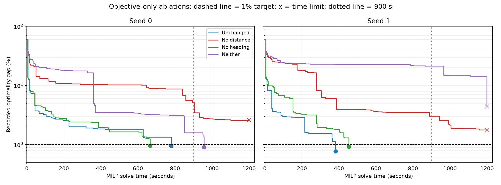

# v16.2 objective ablation: measured results

## Answer

For the current six-flight instance, **removing only the heading-rate penalty
still solved within 900 seconds in both tested seeds**. Removing the distance
penalty while retaining the heading penalty missed the 1% gap target in both
1,200-second runs. Removing both was inconsistent: one run solved in about
957 seconds; the other timed out with a 4.40% gap.

**None of these timeouts was an infeasible model.** Every primary run accepted
a feasible initial route within 0.158 seconds of solver time. The failures were
failures to establish the requested objective quality before the time limit.

## Design and controls

- Source: [main_v16.2_test.py](../../main_v16.2_test.py), unchanged.
- Factors: distance weight 0.1 versus 0; heading weight 0.002 versus 0.
- Time weight 1 and fuel weight 25 remain unchanged.
- Descent is excluded because its weight is already zero. The separate L1
  displacement smoothness expression remains commented out.
- Four cases, each with seeds 0 and 1: **eight sequential fresh-model solves**.
- Same six flights, six grid points, 400-second time step, 25 flight segments,
  19 heading-cost terms, fuel table, initial starts, constraints, and four threads.
- Gurobi 12.0.3; target relative MIP gap 1%; solver limit 1,200 seconds.
- Practical target: 900 seconds, selected for this experiment, not an
  independently established airport operational deadline.
- Model building/export is excluded from solver time. Plotting and downstream
  trajectory NLP are not run.

Tests verified that only the selected objective coefficients change.
All eight runs share original fingerprint `4e261b95`, objective-zeroed
fingerprint `0552a150`, and the same original MIP-start hash. Source/input hashes
also match. The constraints supporting the second differences, hard heading
bounds, speed norm, fuel model, arrival logic, and separation are retained.

## Primary results

The gap in parentheses is the final relative optimality gap. A time-limited
observation is censored: it does not tell us how much longer a 1% solve would take.

| Removed penalty | Seed 0: seconds (gap) | Seed 1: seconds (gap) | Outcome |
|---|---:|---:|---|
| None | 779.692 (0.9533%) | 381.401 (0.7702%) | Both below 900 s |
| Heading only | 665.869 (0.9563%) | 453.625 (0.9217%) | Both below 900 s |
| Distance only | 1,200.154 (2.5907%) | 1,200.192 (1.7430%) | Both time-limited |
| Distance and heading | 956.965 (0.9022%) | 1,200.105 (4.4040%) | One over 900 s; one time-limited |

Small overruns above 1,200 seconds reflect solver termination overhead.



The figure shows sampled callback observations, with the authoritative final
gap appended from each result file. Callbacks are not guaranteed every five
seconds; the step curves show the last recorded observation, not continuous
measurements. Crosses mark time limits; circles mark successful 1% termination.

Evidence:
[combined primary CSV](20261104_combined_results.csv),
[seed 0 summary](20261104_seed0/summary.md),
[seed 1 summary](20261104_seed1/summary.md).
Each case directory contains its solver log, progress CSV, model, parameters,
solution, waypoint CSV, metadata, and final result JSON.

### Why the baseline differs from the reported 470 seconds

The pre-experiment [simulation summary](../../Output/simulation_summary.md)
recorded 470.539 seconds. Our seed-0 baseline reproduced its model fingerprint,
objective, bound, **37,503 nodes, 439,231 simplex iterations, and 622.82 work
units**, but took 779.692 seconds.

Thus the model/search workload was reproduced, while wall-clock throughput
differed. The measured callback overhead was only 2.35 seconds versus the
historical 0.70 seconds; that does not explain the approximately 309-second
difference. The specific machine-load or power-management cause was not
measured. Use the contemporaneous baseline and recorded work as references,
not an assumption that every run must reproduce 470 seconds.

Changing the seed also matters: the seed-1 baseline needed 342.02 work units
and 20,756 nodes rather than 622.82 work units and 37,503 nodes.

## Why the failed runs missed the target

### 1. Feasibility did not disappear

An objective-only change leaves the feasible set unchanged. The accepted starts
and saved solutions demonstrate this directly, and every returned solution
passed the recorded Gurobi feasibility/integrality tolerances.

There were no `INFEASIBLE` or `NUMERIC` statuses and no numerical warnings in
the optimization logs. The existing large-M scaling is not thereby certified
harmless in general, but there is no observed numerical failure to explain here.
An infeasibility IIS would not diagnose these feasible timeouts.

The original script exports trajectories only when its status is `OPTIMAL`.
Consequently, a time-limited run with a feasible incumbent can look like a
complete failure because that output branch is skipped. This experiment saves
the incumbent even on a time limit.

### 2. The same 1% means a much smaller absolute error after dropping distance

Gurobi uses `abs(incumbent - bound) / abs(incumbent)`.
Distance contributes **71.40%** of the seed-0 baseline objective; heading
contributes only **0.48%**.

| Case | Incumbent | Best bound | Absolute gap | Absolute gap allowed at 1% |
|---|---:|---:|---:|---:|
| Baseline, seed 0 | 171,819.658 | 170,181.645 | 1,638.013 | 1,718.197 |
| No distance, seed 0 | 48,438.038 | 47,183.132 | 1,254.906 | 484.380 |
| No distance, seed 1 | 48,246.113 | 47,405.183 | 840.930 | 482.461 |
| Neither, seed 1 | 47,865.056 | 45,757.083 | 2,107.974 | 478.651 |

The distance-only ablations actually ended with *smaller absolute gaps* than
the successful seed-0 baseline, but still failed the percentage criterion.
Their permitted absolute error is about 3.5 times smaller.

Using each matching baseline's absolute error allowance only as a diagnostic,
the no-distance traces first recorded an acceptable absolute gap at 906.792
seconds for seed 0 and 657.828 seconds for seed 1. These are sampled
observations, not alternative benchmark successes. Changing the criterion
would change what "solved" means.

Scale alone does not explain everything: the neither/seed-1 run did not even
reach its matching baseline's larger absolute gap allowance.

### 3. Removing costs did not remove the expensive combinatorial model

Every primary model has 13,767 rows, 57,965 columns, 276 general constraints,
and 44,934 binary variables. **44,352 binaries select fuel-table tetrahedra**
in [fuel_pwl_v1.py](../../Functions/fuel_pwl_v1.py). All primary runs also have
the same presolved dimensions: 14,018 rows, 58,187 columns, 296,906 nonzeros.

The integer fuel-piece selections and speed/arrival/separation logic therefore
remain. Fewer objective terms do not mean a smaller branch-and-bound problem.

The root LP bound was 164,659.4 with both penalties and 42,092.7 without
distance. Relative to the respective returned seed-0 incumbents, the root
shortfall was about 4.17% versus 13.10%. The no-distance runs explored
85,989 and 76,032 nodes, compared with 37,503 and 20,756 for their baselines.

The evidence supports harder objective-bound certification and changed search
decisions. Loss of distance-based guidance/pruning and different fuel/heading
tradeoffs are plausible mechanisms; the logs do not prove a specific internal
branching rule or degeneracy phenomenon caused the slowdown.

### 4. Both-off seed 1 had both an incumbent-search and a bound problem

In the [neither/seed-1 log](20261104_seed1/no_both_seed1/gurobi.log), the
incumbent was still approximately 53,422 immediately before 1,198 seconds.
It improved to 47,865 at 1,198 seconds, just before the time limit. Its final
lower bound, 45,757, still left a 4.40% gap.

The same objective with seed 0 had already found its final 47,047.812 incumbent
at 636.843 seconds and finished the proof to 1% at 956.965 seconds. This is
direct evidence of search-path sensitivity, not a mathematical inability to
solve with both terms absent.

Cross-evaluating all eight saved routes gives a best known both-off incumbent
of 47,047.812. Even combining that route with the failed seed-1 run's lower
bound leaves a 2.74% gap: supplying a better route alone would not make that
particular bound a 1% certificate.

## Additional controlled failure diagnostic

To distinguish poor initialization from continued proof difficulty, the
no-distance/seed-1 case was repeated with the successful both-off/seed-0 solution
as a **complete MIP start**. Objective, constraints, seed, four threads, 1%
target, and 1,200-second limit were unchanged.

The original and diagnostic MPS files are byte-identical after decompression:
`6cbbac6b3d18808e072721947d820160246ef135865532ad07ec7d14b55cf337`.
The solver accepted the supplied route at objective 48,205.341, rather than
the original starting objective of 70,092.104.

| No distance, seed 1 | Original start | Better complete start |
|---|---:|---:|
| Runtime (s) | 1,200.192 | 1,200.166 |
| Final incumbent | 48,246.113 | 48,158.678 |
| Final bound | 47,405.183 | 47,602.719 |
| Final gap | 1.7430% | 1.1544% |
| Nodes | 76,032 | 104,287 |

The better start helped the final gap but **did not meet 1% within 20 minutes**.
Its final incumbent was found at 441.819 seconds; another approximately
758 seconds of search produced no better incumbent. The final absolute gap
was 555.959, versus 481.587 allowed. This strengthens the diagnosis that
optimality-bound certification, not absence of a feasible route, is the
remaining obstacle.

This diagnostic is separate from the eight original-start benchmark runs.
Its changed model fingerprint is expected because MIP-start data can affect
the fingerprint; the exported objective and constraints were verified identical.
Evidence: [diagnostic result](20261104_warm_start/no_distance_seed1/result.json)
and [solver log](20261104_warm_start/no_distance_seed1/gurobi.log).

## Recommendation and limitations

1. **Keep the distance penalty for now** if dependable solve time matters.
   Neither tested seed met 1% after removing only distance, and removing both
   was not consistent.
2. **Removing only heading is computationally viable on this instance.**
   It is not always faster: it helped seed 0 but was slower than baseline
   for seed 1.
3. Runtime success does not preserve route preferences. For seed 0, removing
   heading increased the L1 displacement-change proxy from 414,463 to 541,529,
   about 30.7%. That proxy includes speed changes, not just angular turning.
   The hard heading-change bounds were still active.
4. A longer time limit, different gap target, additional starts, or a stronger
   fuel formulation could be studied separately. They are not verified cures
   here; even the tested better-start diagnostic missed the original target.

Two seeds on one six-flight instance are not a reliability guarantee for other
traffic clusters, horizons, machines, or solver versions. Timeouts are not
proof of divergence or permanent non-convergence. The results concern the
waypoint MILP, not downstream NLP runtime or continuous-time flight safety.

No objective weights or constraints in the original model were changed.
To remove heading in a future model, remove only its objective contribution or
set its weight to zero; do not delete the block that defines the second
differences used by hard constraints.

## Reproduce and verify

See the [runner documentation](../../README_v162_objective_ablation.md).
From the deliverable directory, using the project's configured environment:

```powershell
python .\run_v162_objective_ablation.py --seeds 0 1
python -m unittest test_v162_objective_ablation -v
```

Six focused tests passed. The eight primary runs were independently checked
for unchanged source/starts/constraints, correct weighted objective totals,
solution tolerances, 36 unique flight/step waypoint rows each, and nine nonempty
evidence files per run. The diagnostic additionally passed the identical-MPS
and matched-parameter checks. Temporary smoke-test outputs were removed.

### Research references

- [Gurobi: MIP logging and incumbent versus bound progress](https://docs.gurobi.com/projects/optimizer/en/current/concepts/logging/mip.html)
- [Gurobi: MIP gap definition and certification](https://support.gurobi.com/hc/en-us/articles/8265539575953-What-is-the-MIPGap)
- [Gurobi: determinism, fingerprints, seeds, and time-dependent limits](https://support.gurobi.com/hc/en-us/articles/360031636051-Is-Gurobi-deterministic)
- [Gurobi: why there is no universally best seed](https://support.gurobi.com/hc/en-us/articles/26989631659025-What-is-the-best-seed-value-to-use)
